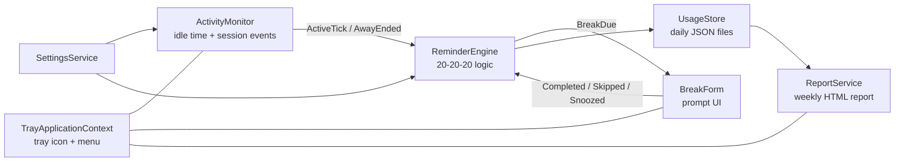

<div align="center">

# 👁️ Screen Health Guard

### Digital Eye-Strain & Screen Health Guard

A lightweight Windows tray app that protects your eyes with the **20-20-20 rule**,
detects unhealthy work patterns, and delivers a **weekly screen-health report**.


</div>

---

## 📖 Overview

Spending hours in front of a screen reduces how often we blink and keeps our eyes focused at one short distance,
which leads to **digital eye strain** (dry, tired eyes, headaches, blurred vision) and poor posture.

**Screen Health Guard** runs quietly in the system tray, understands when you are really working
(and when you have stepped away), and gently reminds you to rest at the right moments.
At the end of each week it gives you a clear report of your habits, with a health score and practical suggestions.

> **The 20-20-20 rule:** every **20 minutes**, look at something **20 feet (6 m)** away for **20 seconds**.

## ✨ Features

| | Feature | Details |
|---|---|---|
| 🔔 | **Reliable 20-20-20 reminders** | After every 20 minutes a notification and a break prompt appear, followed by a 20-second eye-rest countdown. Then the next 20 minutes start (all configurable). |
| 🧠 | **Accurate statistics** | Reading or watching without touching the keyboard still counts toward your 20 minutes. Idle time is tracked separately for the reports. |
| ☕ | **Natural break recognition** | If your PC is locked or asleep for 20 seconds or more, the timer restarts, so you are not nagged right after resting. |
| 🪟 | **Non-intrusive prompt** | Always on top, yet it **never steals keyboard focus**, so your typing is not interrupted. Skip or snooze anytime. |
| ⏸️ | **Pause control** | Pause reminders for 30 minutes, 1 hour or 2 hours (meetings, presentations, gaming). |
| 📊 | **Weekly health report** | A beautiful HTML report with health score, daily screen time, hourly usage heat strip, break compliance and personalised tips. |
| 🌗 | **Dark / light reports** | Reports follow your system theme and work offline in any browser. |
| ⚙️ | **Settings dialog** | Tune every interval, sound, auto-start and automatic reports. |
| 🚀 | **Start with Windows** | Optional per-user auto-start, no administrator rights needed. |
| 🔒 | **Privacy-first** | Only the *time since your last input* is read. No keystrokes, screenshots or window titles. Data never leaves your PC. |

## 🖼️ Screenshots

<!-- Replace these placeholders with real screenshots (create a docs/screenshots folder) -->
| Break prompt | Tray menu | Weekly report |
|:---:|:---:|:---:|
|  |  |  |

## ⬇️ Download

Get the latest ready-to-run build from the **[Releases page](https://github.com/dexel-software-solutions/ScreenHealthGuard/releases)**.

1. Download `ScreenHealthGuard-win-x64.zip` and extract it.
2. Double-click `ScreenHealthGuard.exe`. No installation and no .NET required (self-contained build).
3. Look for the **eye icon** in the system tray (click the `^` arrow if it is hidden).

> **Windows SmartScreen:** because the app is not code-signed, Windows may show *"Windows protected your PC"*.
> Click **More info → Run anyway**. You can review the full source code in this repository.

## 🧭 Using the app

Right-click the tray icon:

| Menu item | What it does |
|---|---|
| **Status line** | Live countdown to your next break (or paused / locked state). Hover the icon to see it too. |
| **Take a break now** | Starts an eye break immediately. |
| **Pause reminders** | Silences reminders for 30 min / 1 h / 2 h. **Resume reminders** appears while paused. |
| **Today's summary** | Screen time, breaks taken/skipped and longest non-stop stretch. (Double-click the icon for the same.) |
| **Weekly report** | Generates and opens the last-7-days report in your browser. |
| **Settings...** | Opens the settings dialog. |
| **Open data folder** | Opens the folder holding your data, reports and logs. |
| **About / Developer on GitHub** | App and developer information. |
| **Exit** | Closes the app. |

A report is also created **automatically every 7 days**, and a notification lets you open it with one click.

## ⚙️ Configuration

All values are available under **Settings...** and are stored in `settings.json`.

| Setting | Default | Allowed range |
|---|---|---|
| Remind me every | 20 min | 1 – 120 min |
| Eye break lasts | 20 s | 10 – 120 s |
| Record me as idle after (statistics only) | 120 s | 30 – 900 s |
| Snooze for | 5 min | 1 – 60 min |
| Start with Windows | On | On / Off |
| Play sound | On | On / Off |
| Automatic weekly report | On | On / Off |

## 📈 How the health score works

The weekly **health score (0 – 100)** combines three simple signals:

| Component | Weight | Full marks when… | Zero when… |
|---|:---:|---|---|
| **Break compliance** (reminded breaks taken ÷ taken + skipped) | 50 | You take every reminded break | You skip them all |
| **Daily screen load** (average active hours/day) | 30 | ≤ 6 hours | ≥ 12 hours |
| **Longest non-stop stretch** | 20 | ≤ 60 minutes | ≥ 180 minutes |

Grades: **85+ Excellent**, **70+ Good**, **50+ Needs attention**, **below 50 At risk**.

## 🏗️ Architecture



* **`ReminderEngine`** contains pure scheduling logic with no UI code, so it is easy to unit test.
* **`ActivityMonitor`** samples presence once per second via the Win32 `GetLastInputInfo` API (timestamp only).
* **`UsageStore`** keeps one small JSON file per day, written atomically to prevent corruption, with automatic 90-day cleanup.
* **`ReportService`** produces a single self-contained HTML file (no external requests).

### Repository structure

```text
ScreenHealthGuard/
├── src/                          # C# source code (the project folder)
│   ├── Infrastructure/           # App info, paths, logging, atomic JSON storage, helpers
│   ├── Models/                   # Settings, daily usage, break types
│   ├── Native/                   # Win32 interop
│   ├── Services/                 # Monitor, reminder engine, usage store, reports, startup
│   ├── UI/                       # Tray shell, break prompt, settings dialog, icon
│   ├── Program.cs
│   └── ScreenHealthGuard.csproj
├── docs/screenshots/             # README images
├── .gitignore
├── LICENSE
└── README.md
```

## 🛠️ Build from source

Only needed if you want to modify the code. To just use the app, see [Download](#️-download).

**Requirements:** Windows 10/11 and the [.NET 10 SDK](https://dotnet.microsoft.com/download/dotnet/10.0).

```powershell
git clone https://github.com/dexel-software-solutions/ScreenHealthGuard.git
cd ScreenHealthGuard/src
dotnet run -c Release
```

## 🔒 Privacy & data

* The app reads **only the time elapsed since your last keyboard/mouse input**. It never reads what you type, click or view.
* No network access, no telemetry, no accounts. Everything stays on your computer.
* Data location: `%LocalAppData%\ScreenHealthGuard`

| Path | Content |
|---|---|
| `settings.json` | Your settings |
| `data\usage-YYYY-MM-DD.json` | Daily statistics (kept for 90 days) |
| `reports\weekly-report-*.html` | Generated reports |
| `logs\app.log` | Diagnostic log (rotated at 1 MB) |

To uninstall completely: exit the app, delete the EXE, delete the folder above and turn off *Start with Windows* in Settings first.

## ❓ Troubleshooting

| Problem | Solution |
|---|---|
| I can't see the tray icon | Click the `^` arrow in the taskbar and drag the eye icon out to pin it. |
| "Already running" message | The app is already in the tray. Only one instance runs at a time. |
| Windows SmartScreen warning | The app is unsigned. Choose **More info → Run anyway**. |
| No notification bubble appears | Windows *Focus Assist / Do Not Disturb* can hide notifications. The on-screen break prompt still appears. |
| Start with Windows does nothing | Run `ScreenHealthGuard.exe` (not `dotnet run`), then enable the option in Settings. |
| Something looks wrong | Open **Open data folder → logs → app.log**, and please [open an issue](https://github.com/dexel-software-solutions/ScreenHealthGuard/issues). |

## 🗺️ Roadmap

- [ ] Blink-rate reminders and posture tips
- [ ] Per-application time breakdown (opt-in)
- [ ] CSV / PDF export of reports
- [ ] Do-not-disturb detection (full-screen apps and presentations)
- [ ] Multi-language interface (including Sinhala and Tamil)
- [ ] Installer (MSIX) and code signing

## 🤝 Contributing

Contributions, ideas and bug reports are welcome.

1. Fork the repository and create a branch: `git checkout -b feature/my-idea`
2. Commit your changes with a clear message.
3. Push the branch and open a Pull Request describing what and why.

## ⚠️ Disclaimer

Screen Health Guard is a general wellness tool and **does not provide medical advice**.
If you experience persistent eye discomfort, headaches or vision changes, please consult an eye-care professional.

## 📄 License

Released under the [MIT License](LICENSE).

## 👨‍💻 Developer

**Demiyan Dissanayake**

* GitHub: [github.com/dexel-software-solutions](https://github.com/dexel-software-solutions)
* Email: [demiyandissanayake@gmail.com](mailto:demiyandissanayake@gmail.com)
* Email: [dexelsoftwaresolutions@gmail.com](mailto:dexelsoftwaresolutions@gmail.com)

<div align="center">

⭐ If this project helps you, please consider giving it a star on GitHub. ⭐

</div>
